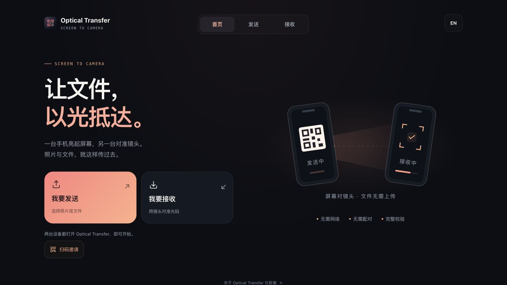

  
  <h1>Optical Transfer</h1>
  
让文件和文字，以光抵达。

  

    
    
  

  

    
    
  

  
<a href="README.md">简体中文</a> · <a href="README_EN.md">English</a> · <a href="https://github.com/TatsuhiroC/optical-transfer-pwa/issues">反馈问题</a>

用屏幕和摄像头，在手机、电脑之间传照片、文件和文字。**无需账号，无需配对，无需上传服务器**，两台设备也不必连接同一个 Wi-Fi。

## 有什么好用的

- **文件、文字分开接收**：选照片或拖入文件，也能输入、粘贴最多 4 MiB 文字。文字可直接复制，TXT 文档仍保留为文件。
- **小内容，一张码**：装得下就显示静态二维码；较大内容自动切换喷泉动态码。
- **容忍漏扫，收完再校验**：动态传输允许漏帧、重复和乱序，收集足够信息并通过完整性校验后，才提供导出。
- **进度看得明白**：接收速度、已用时间、预计剩余时间（ETA）一起显示；大文件自动以 MB 显示。
- **保存、分享、继续转发**：接收后可保存文件、复制文字，或交给下一台设备；转发保留文件与文字的区别。系统分享取决于设备支持。
- **扫码邀请同伴**：首页点“扫码邀请”，对方扫描网址二维码即可找到同一个首页。
- **手机和电脑都能用**：浏览器直接打开，可安装到桌面；Android 还提供正式签名 APK。
- **中英文切换**：界面适配手机与电脑，语言选择会被记住。

最近的容量优化让默认每帧多装 **100 字节，约 4.45%**，二维码尺寸和纠错强度保持不变。这是容量提升，实际速度仍取决于设备与环境。

## 三步开始

1. **两台设备打开应用**，也可以用“扫码邀请”让同伴找到首页。
2. **发送端选择文件或输入文字**，保持二维码显示在屏幕上。
3. **接收端进入“接收”页并开启摄像头**，对准二维码，校验通过后保存文件或复制文字。

提高发送端亮度，让完整二维码落在取景框内，并保持两台设备稳定。

## 安装与离线使用

- **iPhone / iPad**：Safari 打开网页 → 分享 → 添加到主屏幕。
- **Android**：安装 [最新 APK](https://github.com/TatsuhiroC/optical-transfer-pwa/releases/latest)，或在浏览器菜单中安装 PWA。
- **电脑**：直接使用网页版，也可在支持的浏览器中安装 PWA。

网页首次加载和网址邀请需要网络；网页资源缓存完成后可离线传输，APK 自带所需资源。

## 常见问题

**能传多大的文件？** 默认参数最多 **64 MiB**。更适合照片和小文件，大文件需要较长时间。

**为什么传得慢？** 速度取决于二维码清晰度、摄像头和光照。先用默认参数，提高亮度、保持稳定。ETA 是估计值，会随接收情况调整。

**文件会上传吗？** 不会上传服务器。光学通道传输的是明文数据，文件校验用于检测传输错误，不提供加密。

[开发与部署](docs/development.md) · [传输原理与参数](docs/protocol.md) · [更新记录](https://github.com/TatsuhiroC/optical-transfer-pwa/releases)

## 致谢

基于 [BashAlarmist 的 decimen-optical-transfer](https://github.com/bashalarmistalt/decimen-optical-transfer)，由 [TatsuhiroC](https://github.com/TatsuhiroC) 扩展为同时支持发送与接收的 PWA 和 Android 应用。

[MIT](LICENSE) · Copyright © 2026 BashAlarmist · 项目扩展：TatsuhiroC
