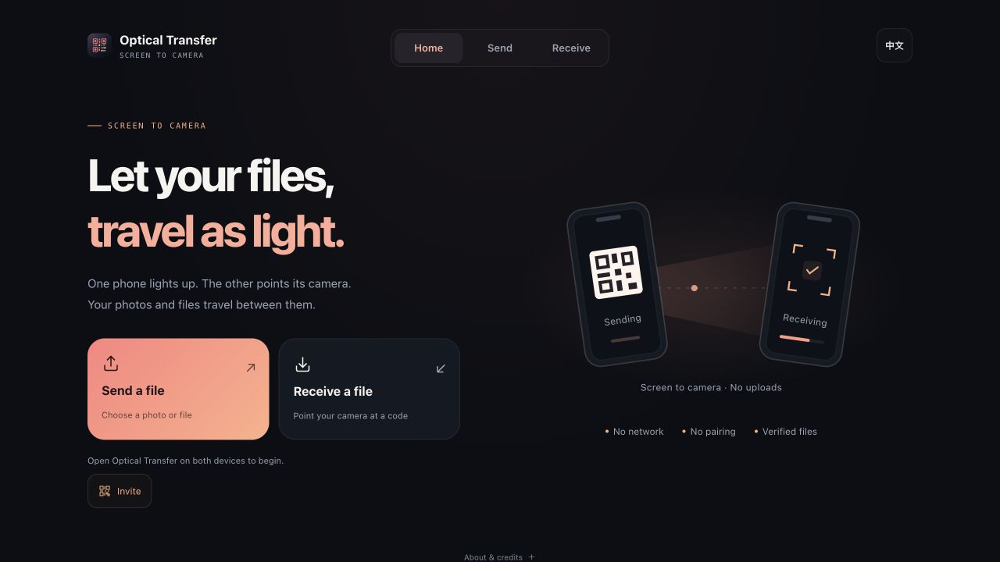

  
  <h1>Optical Transfer</h1>
  
Send files with a screen and a camera.

  

    
    
  

  

    
    
  

  
<a href="README.md">简体中文</a> · <a href="README_EN.md">English</a> · <a href="https://github.com/TatsuhiroC/optical-transfer-pwa/issues">Feedback</a>

One device displays animated QR codes. The other scans them with its camera. Transfer photos and files **without pairing or uploading them to a server**.

## Features

- **Photos and files**: choose from your phone’s library or drag a file in on desktop.
- **Phone and desktop transfers**: use a browser or install the Android APK.
- **QR invitations**: tap “Invite” on the home page so a friend can scan and open the same site.
- **Save, share and forward**: export or relay a file after its integrity check passes.
- **English and Chinese**: switch languages; your choice is remembered.

## Start in three steps

1. **Open the app on both devices.** Use “Invite” to help the other person find it.
2. **Choose a file on the sender** and keep the animated codes on screen.
3. **Start the receiver’s camera**, point it at the code, and save after verification.

Raise the sender’s brightness, keep the whole QR code in view, and hold both devices steady.

## Install and use offline

- **iPhone / iPad**: open in Safari → Share → Add to Home Screen.
- **Android**: install the [latest APK](https://github.com/TatsuhiroC/optical-transfer-pwa/releases/latest), or install the PWA from your browser menu.
- **Desktop**: use the web app directly, or install the PWA in a supported browser.

The first web visit and URL invitations need a network connection. Once its assets are cached, the web app can transfer offline; the APK includes the required assets.

## FAQ

**How large can a file be?** Up to **64 MiB with default settings**. Photos and small files are a better fit; larger files take longer.

**Why is it slow?** Speed depends on code clarity, the camera and lighting. Start with defaults, raise screen brightness, and hold steady.

**Are files uploaded?** No files are uploaded to a server. The optical channel carries plaintext; the integrity check detects transfer errors and does not encrypt files.

[Development & deployment](docs/development.md) · [Protocol & settings](docs/protocol.md) · [Release notes](https://github.com/TatsuhiroC/optical-transfer-pwa/releases)

## Credits

Based on [BashAlarmist’s decimen-optical-transfer](https://github.com/bashalarmistalt/decimen-optical-transfer), extended by [TatsuhiroC](https://github.com/TatsuhiroC) into a PWA and Android app with both sending and receiving.

[MIT](LICENSE) · Copyright © 2026 BashAlarmist · Extensions by TatsuhiroC
